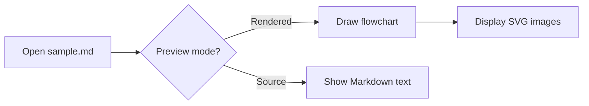

# Markdown preview sample

Open this file in the web terminal file browser. The diagram should appear as a rendered flowchart, followed by two copies of the blue SVG card. Switch between **Source** and **Rendered** in the preview toolbar to compare.

## Mermaid flowchart

## SVG with Markdown image syntax

## SVG with an HTML image tag

The two images should remain visible even if you browse to another folder while this preview stays open.
